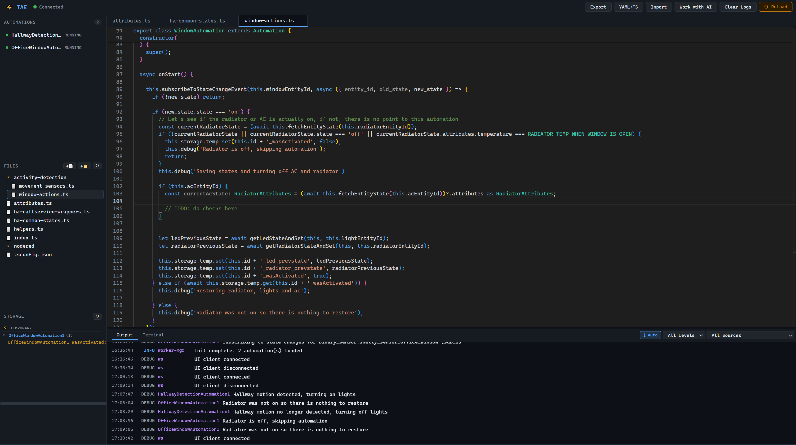

# TypeScript Automation Engine (TAE)

Write and run Home Assistant automations in TypeScript, with a managed runtime, a built-in editor, tests that touch no device, and a tool set an AI can use to do the whole job: look up your entities, write the code, test it, reload it and read the logs.

## Features

- **TypeScript automations** - Write automations in TypeScript with full type safety and autocomplete
- **Worker thread isolation** - Automations run in a dedicated worker thread for clean reloads and fault isolation
- **Built-in editor** - Monaco-based editor with TypeScript IntelliSense, syntax highlighting, and multi-tab support
- **Made for AI work** - Automations are ordinary TypeScript, which AI models write well, and TAE gives the AI what it needs to check its own work: entity search, a type checker, simulated tests, logs and a timeline. See [Working with AI](#working-with-ai)
- **Built-in AI chat and completions** - An AI chat that looks up entities, edits your files (each change approved by you), type-checks, tests, reloads and reads logs, plus inline completions. Works with Anthropic (Claude), OpenAI, GitHub Models and DeepSeek
- **MCP server** - The same 30 tools for Claude Code and other MCP clients, so an AI on your computer can build and maintain your automations
- **AI text in automations** - `this.ai.generate()` writes spoken announcements, notification wording or summaries from inside an automation, with your provider and key
- **Tests** - Simulated runs of your automations: set states, skip time, restart TAE, check what they call and with which data. No device is touched, and waits are instant
- **Your own entities** - Automations publish sensors and binary sensors to Home Assistant over MQTT; TAE's status and a switch per automation show up there too
- **Workspace in git** - The workspace is a git repository with a clonable mirror; secret files stay out of it
- **Timeline** - What each automation did, run by run: trigger, service calls, logs, errors and timings
- **File history** - Every save and AI edit is versioned; compare and restore any version, including deleted files
- **Entity help in the editor** - Autocomplete and hover for entity ids, with a warning and quick fix for typos
- **Code snippets** - Define reusable code templates in `.snippets` files with tab-stop placeholders
- **File management** - Create, rename, delete, and drag-drop files/folders directly in the UI
- **Lifecycle management** - Predictable automation lifecycle (`onStart` → `onStop` → `onReload` → `onUnload`)
- **HA integration** - Full WebSocket connection to Home Assistant for calling services, subscribing to events, and monitoring state changes
- **Persistent storage** - SQLite-backed key/value storage that survives restarts, plus in-memory temp storage
- **Real-time logging** - View logs in the UI with level and source filters; auto-scroll toggle to lock the view to the latest entry
- **Storage viewer** - Inspect persistent (SQLite) and temporary (in-memory) storage in real time from the sidebar
- **External sync** - Import/export automations to `/share/tae` for backup and version control



## Installation

[](https://my.home-assistant.io/redirect/supervisor_add_addon_repository/?repository_url=https%3A%2F%2Fgithub.com%2FCycov%2Fcycov-home-assistant)

1. In Home Assistant, go to **Settings → Add-ons → Add-on Store → ⋮ → Repositories**
2. Add the repository URL: `https://github.com/Cycov/cycov-home-assistant`
3. Find **TypeScript Automation Engine** in the store and click **Install**
4. Start the addon and open the **TAE** panel in your sidebar

## Quick Start

1. Open the TAE panel in your Home Assistant sidebar
2. Edit `automations/index.ts` in the built-in editor
3. Click **⟳ Reload** to apply changes

## Working with AI

TAE was built so that an AI assistant can do real automation work, not just suggest code for you to paste. Two things make that possible.

**The automations are plain TypeScript.** One class per automation, a handful of methods (`subscribeToStateChangeEvent`, `callService`, `getEntityState`, timers, storage). There is no YAML dialect or template language to get subtly wrong, and anything code can do is available: state kept between events, shared helper functions, HTTP requests, parsing. Models are good at this kind of code.

**The AI can check its own work.** A model that can only write code guesses at entity ids and can't tell whether its automation works. Through TAE's tools it can:

| Step | Tools | Why it matters |
|------|-------|----------------|
| Learn the API | `get_api_reference` | The whole automation API with patterns and rules, in one call |
| Know your home | `search_entities`, `get_entity`, `list_areas`, `list_services`, `get_memory` | Real entity ids, attributes and service fields instead of guesses; notes about what you call things |
| Read and write code | `list_files`, `read_file`, `edit_file`, `write_file`, `delete_file` | Works in the workspace TAE runs |
| Catch mistakes early | `type_check` | Compiler errors, plus entity ids that don't exist |
| Prove behaviour | `save_test`, `run_test`, `list_tests`, `get_test` | Simulated states and clock: "off 3 minutes after motion clears" is checked in milliseconds, with no light switching |
| Go live | `reload_automations`, `set_automation_state`, `list_automations` | Applies the code and shows what is running or in error |
| See what happened | `get_logs`, `get_automation_timeline` | What triggered each run and what it called, for debugging real behaviour |
| Keep a record | `workspace_changes`, `commit_changes`, `workspace_log`, `file_history`, `restore_file_version` | Reviewable diffs, named commits, and a way back |
| Remember | `remember`, `update_memory`, `forget` | Notes that carry over to later chats |
| Touch the real home | `call_service` | Only when you ask it to try something |

So a request like "light the hallway strip on motion, dimmer after goodnight, and turn it off five seconds after the last sensor clears" becomes a loop the AI runs by itself: look up the sensors and the light, write the automation, type-check, write a test scenario and run it, fix what the test shows, reload, read the logs, commit.

### What works well

- **Rules with memory**: "who turned this light on", "has it been quiet for 20 minutes", "which room was the vacuum heading to". These are fields and timers in a class, where a YAML automation needs helper entities and several automations that have to agree.
- **Behaviour that depends on time**: tests run on a simulated clock, so timeouts, delays and "only after 23:00" are checked instantly and repeatably. `startTime` sets the time of day; a **Restart TAE** step checks what survives a restart.
- **Changing existing automations**: the AI reads the file, the tests saved with it and its history, changes it, and reruns the tests to see it didn't break what worked.
- **Explaining**: ask why something happened and the AI reads the timeline and logs instead of speculating.
- **Reasons kept with the code**: a file header saying what a rule is for and what was tried survives the chat that produced it. Ask the AI to write one; later sessions (and you) read it first.

### What to know before relying on it

- **Tests simulate Home Assistant, not your devices.** A test proves the automation makes the right calls. It can't show that a device accepts them, or how an integration behaves. Try new device actions once for real (a test with **Send calls to Home Assistant**, or `call_service`).
- **AI calls are not made in tests**: `this.ai.generate` returns a placeholder there, and network requests from automation code are blocked.
- **The built-in chat asks before every change; MCP does not.** Over MCP, your client's own permission prompts are the safety net (see below). `call_service` controls real devices either way.
- **TAE's tools stop at the workspace.** They don't edit Home Assistant's own configuration (`configuration.yaml`, scripts, helpers). An automation that needs a new helper or script still needs you, or a client with other access, to add it.
- **Everything runs in one add-on.** If TAE is stopped, its automations stop. TAE publishes `sensor.tae_status` to Home Assistant, so a short Home Assistant automation can tell you when that happens.
- **AI use costs money** where your provider charges for it: the chat shows an estimate per reply, and `this.ai.generate` logs each request's cost and is limited to 30 an hour per automation.

### Three ways to use it

1. **The built-in chat** (🤖 AI in the editor): nothing to install, every change shown as a diff to allow or deny. See [AI Integration](#ai-integration).
2. **Claude Code or another MCP client** on your computer: the same tools, with the client's larger context and its own approvals. Best for bigger pieces of work. See [MCP Server](#mcp-server-claude-code-and-other-ai-apps).
3. **Any other assistant**: download the entity list and `SKILL.md` from **Work with AI** in the toolbar, give them to the assistant, and paste its code into the editor.

## Writing Automations

Every automation is a class that extends `Automation`:

```typescript
import { Automation, registerAutomation, startAutomation, LogLevel } from 'tae';

class MotionLightAutomation extends Automation {
  async onStart() {
    // Subscribe to a binary sensor state change
    this.subscribeToStateChangeEvent(
      'binary_sensor.hallway_motion',
      async (data) => {
        if (data.new_state?.state === 'on') {
          // Turn on a light
          await this.callService('light', 'turn_on', {
            entity_id: 'light.hallway',
            brightness: 200,
          });
          this.log('Hallway light turned on due to motion');
        } else if (data.new_state?.state === 'off') {
          await this.callService('light', 'turn_off', {
            entity_id: 'light.hallway',
          });
          this.log('Hallway light turned off');
        }
      }
    );

    this.log('Motion light automation started');
  }

  async onStop() {
    this.log('Motion light automation stopped');
  }
}

// Register and start in the onInit export
export function onInit() {
  const motionLight = new MotionLightAutomation();
  registerAutomation(motionLight);
  startAutomation(motionLight);
}
```

### Entry Point

Your `automations/index.ts` must export an `onInit()` function. This is called by the engine after loading the file. Register and start all your automations here:

```typescript
export function onInit() {
  // Create instances, register, and start
  const auto1 = new MyAutomation();
  registerAutomation(auto1);
  startAutomation(auto1);

  const auto2 = new AnotherAutomation('custom-id');
  registerAutomation(auto2);
  startAutomation(auto2);
}
```

### Organizing Automations

You can split automations into multiple files. Create files/folders in the built-in editor and import them:

```
automations/
  index.ts              ← entry point
  lights/
    motion-light.ts     ← automation class
    sunset-dimmer.ts
  climate/
    thermostat.ts
  utils/
    helpers.ts          ← shared utilities
```

```typescript
// automations/index.ts
import { registerAutomation, startAutomation } from 'tae';
import { MotionLightAutomation } from './lights/motion-light';
import { ThermostatAutomation } from './climate/thermostat';

export function onInit() {
  const motionLight = new MotionLightAutomation();
  registerAutomation(motionLight);
  startAutomation(motionLight);
  // ...
}
```

## Automation Lifecycle

| Hook         | When Called                                                | Use For                                    |
|--------------|-----------------------------------------------------------|--------------------------------------------|
| `onStart()`  | Automation enters running state                           | Setting up subscriptions, initial logic     |
| `onStop()`   | Automation is stopped (via UI, API, reload or shutdown)   | Cleaning up timers and non-sub resources    |
| `onReload()` | Engine is about to reload (before `onStop()`/`onUnload()`); fresh instances are then created from the new code | Saving state the new instance should pick up |
| `onUnload()` | Automation is permanently removed (reload or shutdown)    | Final cleanup                               |

**Important:** Event subscriptions are automatically cleaned up on stop - you do NOT need to manually unsubscribe in `onStop()`.

**Errors:** if a subscription callback throws (or an awaited `callService` fails), the error is logged and shown as ⚠ next to the automation, and the automation **keeps running**. Only an error in `onStart()` puts it in the `error` state. If the worker thread itself dies, TAE restarts it automatically (with backoff).

## API Reference

### Constructor

```typescript
class MyAutomation extends Automation {
  constructor() {
    // Auto-generated ID: "MyAutomation1", "MyAutomation2", ...
    super();

    // Or specify a custom ID:
    super('my-custom-id');
  }
}
```

### Calling Home Assistant Services

Invoke any HA service. This is equivalent to calling a service from Developer Tools → Services.

```typescript
const result = await this.callService(domain, service, data?, options?)
```

| Parameter | Type     | Description                                                    |
|-----------|----------|----------------------------------------------------------------|
| `domain`  | `string` | The service domain - the part before the dot in HA service calls. This is the integration or platform name. Examples: `"light"`, `"switch"`, `"climate"`, `"notify"`, `"media_player"`, `"automation"`, `"scene"`, `"script"`, `"input_boolean"`, `"input_number"`, `"input_select"`, `"input_text"`, `"cover"`, `"fan"`, `"vacuum"`, `"lock"`, `"alarm_control_panel"`, `"camera"`, `"tts"`, `"number"`, `"select"`, `"button"` |
| `service` | `string` | The service action - the part after the dot. This tells HA what to do. Examples: `"turn_on"`, `"turn_off"`, `"toggle"`, `"set_temperature"`, `"send_message"`, `"set_hvac_mode"`, `"set_value"`, `"select_option"`, `"press"`, `"set_cover_position"`, `"set_speed"`, `"start"`, `"stop"`, `"set_volume_level"`, `"play_media"` |
| `data`    | `object` | Optional service data payload. Almost always includes `entity_id` to target specific entities. Other parameters are service-specific - check HA Developer Tools → Services for the available fields for each service. |
| `options` | `object` | Optional. `{ returnResponse: true }` for services that return data (`weather.get_forecasts`, `calendar.get_events`, `todo.get_items`, …). |
| **Returns** | `Promise<any>` | Resolves with the HA service response (usually `null` for fire-and-forget services); with `returnResponse`, the service's response data. |

**Examples:**

```typescript
// Turn on a light with brightness and color temperature
await this.callService('light', 'turn_on', {
  entity_id: 'light.living_room',
  brightness: 200,
  color_temp_kelvin: 2850,
});

// Turn off multiple lights
await this.callService('light', 'turn_off', {
  entity_id: ['light.kitchen', 'light.hallway'],
});

// Send a mobile notification
await this.callService('notify', 'mobile_app_your_phone', {
  message: 'Motion detected in the garage!',
  title: 'Security Alert',
  data: { priority: 'high' },
});

// Set thermostat temperature
await this.callService('climate', 'set_temperature', {
  entity_id: 'climate.living_room',
  temperature: 22,
  hvac_mode: 'heat',
});

// Run a script
await this.callService('script', 'turn_on', {
  entity_id: 'script.goodnight_routine',
});

// Toggle a switch
await this.callService('switch', 'toggle', {
  entity_id: 'switch.garage_door',
});

// A service that returns data
const response = await this.callService('weather', 'get_forecasts',
  { entity_id: 'weather.forecast_home', type: 'daily' }, { returnResponse: true });
const today = response['weather.forecast_home'].forecast[0]; // { condition, temperature, templow, ... }
```

### Subscribing to Events

Listen for native Home Assistant events. This is a low-level API - for state changes, prefer `subscribeToStateChangeEvent` instead.

```typescript
// Subscribe to a specific HA event type
const unsub = this.subscribeToEvent(eventType, callback);
```

| Parameter   | Type       | Description                                                    |
|-------------|------------|----------------------------------------------------------------|
| `eventType` | `string`   | HA event type to listen for. Common types: `"state_changed"` (any entity state update), `"call_service"` (any service call), `"zha_event"` (Zigbee Home Automation device events), `"deconz_event"` (deCONZ device events), `"timer.finished"` (timer expired), `"automation_triggered"` (native HA automation triggered), `"script_started"`, `"homeassistant_start"`, `"homeassistant_stop"`. Find event types in HA Developer Tools → Events. |
| `callback`  | `function` | Called each time the event fires. Receives the full HA event object with properties: `event_type` (string), `data` (event-specific payload object), `origin` ("LOCAL" or "REMOTE"), `time_fired` (ISO timestamp), `context` ({ id, parent_id, user_id }). |
| **Returns** | `() => void` | An unsubscribe function. Call it to stop listening before automation stop. Not required - all subscriptions are auto-cleaned on stop. |

```typescript
// Listen for ZHA (Zigbee) remote button events
this.subscribeToEvent('zha_event', (event) => {
  if (event.data.device_ieee === '00:11:22:33:44:55:66:77') {
    if (event.data.command === 'toggle') {
      this.callService('light', 'toggle', { entity_id: 'light.bedroom' });
    }
  }
});

// Listen for timer events
this.subscribeToEvent('timer.finished', (event) => {
  this.log('Timer finished!', event.data);
});
```

### Subscribing to State Changes

The most common way to react to entity changes. Fires whenever a specific entity (or any entity) changes state.

```typescript
// Watch a specific entity
const unsub = this.subscribeToStateChangeEvent(entityId, callback);

// Watch ALL entity state changes (use sparingly - fires frequently)
const unsub = this.onStateChange(callback);
```

| Parameter  | Type       | Description                                                    |
|------------|------------|----------------------------------------------------------------|
| `entityId` | `string`   | The full entity ID to watch. This is the entity's unique identifier in HA (e.g., `"binary_sensor.front_door"`, `"sensor.living_room_temperature"`, `"light.bedroom"`, `"switch.coffee_maker"`, `"person.john"`). Find entity IDs in HA → Settings → Devices & Services → Entities. |
| `callback` | `function` | Called with a `StateChangeData` object containing: `entity_id` (string - the entity that changed), `old_state` (previous `HAEntityState \| null` - null if entity was just created), `new_state` (new `HAEntityState \| null` - null if entity was removed). Each state object has: `.state` (string value like `"on"`, `"off"`, `"22.5"`, `"home"`), `.attributes` (object with device-specific data), `.last_changed` (ISO timestamp when state value changed), `.last_updated` (ISO timestamp when any attribute changed). |
| `emitAll` | `boolean?` | Default `false`: the callback only runs when the state **value** changes (attribute-only updates and entity removals are skipped). Pass `true` to receive every update, e.g. to react to brightness or temperature attributes. |
| **Returns** | `() => void` | Unsubscribe function. Optional - auto-cleaned on stop. |

```typescript
// Monitor a door sensor
this.subscribeToStateChangeEvent('binary_sensor.front_door', async (data) => {
  if (data.new_state?.state === 'on') {
    this.log('Front door opened!');
    // data.old_state?.state  = previous state
    // data.new_state.attributes = current attributes
  }
});

// Monitor all temperature sensors
this.onStateChange((data) => {
  if (data.entity_id.startsWith('sensor.') && data.entity_id.includes('temperature')) {
    const temp = parseFloat(data.new_state?.state || '0');
    if (temp > 30) {
      this.warn(`High temperature: ${data.entity_id} = ${temp}°C`);
    }
  }
});
```

### Getting Entity State

Read the current state of any entity without subscribing to changes.

```typescript
// From TAE's local copy of all states (no network call)
const state = await this.getEntityState('sensor.temperature');

// Same, synchronous - handy in helper functions
import { getEntityState } from 'tae';
const guestMode = getEntityState('input_boolean.guest_mode')?.state === 'on';

// Live from HA (network call to HA API - always fresh but slower)
const state = await this.fetchEntityState('sensor.temperature');
```

| Method | Parameter | Returns | Description |
|--------|-----------|---------|-------------|
| `this.getEntityState` | `entityId: string` | `Promise<HAEntityState \| undefined>` | Reads TAE's local copy of all states, kept in sync with HA. The copy is updated before state-change callbacks run, so it is current inside a callback. Returns `undefined` if the entity doesn't exist. |
| `getEntityState` (standalone) | `entityId: string` | `HAEntityState \| undefined` | Same data, **synchronous**. |
| `fetchEntityState` | `entityId: string` | `Promise<HAEntityState \| undefined>` | Makes a live API call to Home Assistant for one entity. Rarely needed. |

The returned state object:

```typescript
{
  entity_id: 'sensor.temperature',
  state: '22.5',                          // Always a string
  attributes: {
    unit_of_measurement: '°C',
    friendly_name: 'Living Room Temperature',
    device_class: 'temperature',
    // ... other entity-specific attributes
  },
  last_changed: '2024-01-15T10:30:00.000Z',
  last_updated: '2024-01-15T10:30:00.000Z',
  context: { id: '...', parent_id: null, user_id: null },
}
```

### Logging

All log methods accept any type for the message (string, object, number, etc.). Objects are automatically pretty-printed in both the console and UI.

The `log_level` addon config only filters **console** output. All log levels are always sent to and visible in the UI (use the UI dropdown to filter there).

```typescript
// Standard level methods
this.log('Something happened');           // INFO level
this.warn('Watch out!');                  // WARN level
this.error('Something broke!');           // ERROR level
this.debug('Detailed info');              // DEBUG level

// Log with a specific level override (second param is LogLevel)
this.log('Verbose detail', LogLevel.Debug);     // Uses DEBUG level
this.log('Critical issue', LogLevel.Error);     // Uses ERROR level

// Log objects - automatically pretty-printed in console and UI
this.log({ entities: ['light.a', 'light.b'], brightness: 200 });

// Log with extra data attached (rendered as expandable block in UI)
this.log('Service called', { domain: 'light', service: 'turn_on' });
```

| Method | Signature | Description |
|--------|-----------|-------------|
| `this.log()` | `(message: any, levelOrExtra?: LogLevel \| any)` | Logs at INFO level by default. Pass a `LogLevel` value as second arg to override the level, or pass any other value to attach it as extra data. |
| `this.warn()` | `(message: any, extra?: any)` | Logs at WARN level. |
| `this.error()` | `(message: any, extra?: any)` | Logs at ERROR level. |
| `this.debug()` | `(message: any, extra?: any)` | Logs at DEBUG level. |

**LogLevel enum values:** `LogLevel.Debug`, `LogLevel.Info`, `LogLevel.Warn`, `LogLevel.Error`

Import LogLevel:

```typescript
import { LogLevel } from 'tae';
```

### Storage

Each automation gets its own namespaced key-value storage. Keys from different automations never collide - the namespace is the automation's ID.

| Storage Type | Backed By | Survives Restart | Use For |
|-------------|-----------|------------------|---------|
| `this.storage.persistent` | SQLite (WAL mode) | ✅ Yes | Timestamps, counters, user preferences, state that must survive restarts |
| `this.storage.temp` | In-memory Map | ❌ No | Caches, debounce flags, temporary counters, rate limiting |

All storage methods are async and return Promises.

```typescript
// Persistent storage (SQLite-backed, survives restarts)
await this.storage.persistent.set('lastMotionTime', Date.now());
const lastMotion = await this.storage.persistent.get('lastMotionTime');  // returns the value or undefined
await this.storage.persistent.delete('lastMotionTime');

// Temporary storage (in-memory, cleared on restart)
await this.storage.temp.set('counter', 0);
const counter = await this.storage.temp.get('counter');
await this.storage.temp.delete('counter');
```

Values are JSON-serialized, so you can store strings, numbers, booleans, arrays, and plain objects.

### AI Text

`this.ai.generate(prompt, options?)` writes text with the AI provider set in TAE's AI settings (see [AI Integration](#ai-integration)), for example a spoken good-morning message or the wording of a notification.

```typescript
let message = `Good morning, it's ${time}.`; // keep a fallback
try {
  message = await this.ai.generate(`It is ${time}. Weather today: ${weather}. Write a short good-morning message.`, {
    system: 'You are a cheerful home assistant. One or two sentences, plain text, it will be spoken aloud.',
  });
} catch (err: any) {
  this.warn(`AI text failed: ${err.message}`);
}
```

| Option | Description |
|--------|-------------|
| `system` | Instructions: role, tone, language, length, format |
| `model` | `"fast"` (default) uses the **Automations model** from AI settings; `"smart"` uses the chat model |
| `maxTokens` | Answer length cap (default 500, at most 4000) |
| `timeoutMs` | Give up after this long (default 30 s, at most 120 s) |

The **Automations model** in AI settings picks the model: the same as inline completions (default), the same as the chat, or a custom one (for example a cheap model just for automations). It rejects when AI isn't configured, the request fails or times out, or the automation passes **30 requests per hour**, so always keep a fallback. Each request's model, tokens and approximate cost are written to the automation's log. In tests it returns a placeholder (`[AI text for: …]`) without calling the AI; live test runs use the real AI.

### Publishing Entities

`this.publish.sensor(objectId, options?)` and `this.publish.binarySensor(objectId, options?)` publish your own entities to Home Assistant over MQTT, for values an automation computes or fetches (a forecast from an API, a derived "someone home" flag). They show up under the **TAE** device as `sensor.<objectId>` / `binary_sensor.<objectId>`, keep their state across HA restarts, and work in dashboards and other automations like any entity.

```typescript
const forecast = this.publish.sensor('outdoor_feel', { name: 'Feels like', unit: '°C', deviceClass: 'temperature' });
await forecast.set(8.5, { source: 'meteoblue' });   // state (null = unknown) + optional attributes
await this.publish.binarySensor('rain_soon', { name: 'Rain soon' }).set(true);
```

Options: `name`, `icon`, `unit`, `deviceClass`, `stateClass`. This needs the **Mosquitto broker** app; TAE finds it on its own. Without it, `set()` rejects and explains what's missing.

### TAE in Home Assistant

With the Mosquitto broker app installed, TAE also shows itself in HA under the **TAE** device:

- `sensor.tae_status`: `running` or `stopped`, with the version and how many automations run, are stopped or have errors
- one switch per automation (`switch.tae_<automation>`, e.g. `switch.tae_spotify_follows_pc`): on while the automation runs; switching it starts or stops the automation. Attributes carry its state and last error

Switches of automations you delete are removed from HA after the next load.

### Standalone Functions

These functions provide the same capabilities as instance methods but can be used outside of an automation class - e.g., in `onInit()` or utility modules.

```typescript
import {
  registerAutomation,  // Register automation with the engine (must call before start)
  startAutomation,     // Start a registered automation (calls onStart)
  stopAutomation,      // Stop a running automation (calls onStop)
  callService,         // Call HA service: callService(automation, domain, service, data?)
  subscribeToEvent,    // Subscribe: subscribeToEvent(automation, eventType, callback)
  subscribeToStateChangeEvent,  // State sub: subscribeToStateChangeEvent(automation, entityId, callback)
  onStateChange,       // All states: onStateChange(automation, callback)
  getEntityState,      // Synchronous state read: getEntityState(entityId)
  fetchEntityState,    // Live state from HA: await fetchEntityState(entityId)
  getAutomations,      // Registered automations: [{ id, className, state }]
  log, warn, error, debug,  // Standalone logging (source shown as "user")
  LogLevel,            // Enum: LogLevel.Debug, LogLevel.Info, LogLevel.Warn, LogLevel.Error
} from 'tae';
```

The HA API functions require passing the automation instance as the first argument:

```typescript
const myAuto = new MyAutomation();
registerAutomation(myAuto);
startAutomation(myAuto);

// Explicit API style
await callService(myAuto, 'light', 'turn_on', { entity_id: 'light.x' });
const unsub = subscribeToEvent(myAuto, 'zha_event', (e) => { /* ... */ });

// Standalone logging (not tied to any automation)
log('Application started');
debug('Init details', { automationsLoaded: 3 });
```

## Automation Identity

```typescript
// Auto-generated ID (ClassName + incrementing counter)
new MotionLightAutomation()     // → id: "MotionLightAutomation1"
new MotionLightAutomation()     // → id: "MotionLightAutomation2"

// Explicit ID (useful for storage namespace consistency)
new MotionLightAutomation('my-motion-light')  // → id: "my-motion-light"
```

## Built-in Editor (UI)

The addon provides a full-featured IDE accessible from the Home Assistant sidebar panel.

### Layout

The UI is divided into four areas:

1. **Header bar** (top) - Shows connection status, and buttons for Export, Import, Clear Logs, Work with AI, and Reload.
2. **Sidebar** (left) - Two sections:
   - **Automations** - Lists all registered automations with their state (running/stopped/error). Hover to reveal Start/Stop buttons.
   - **Files** - File tree with buttons to create files (+📄), create folders (+📁), and refresh (↻).
3. **Editor** (center) - Monaco-based TypeScript editor with tabs. Supports:
   - Full TypeScript IntelliSense with TAE API autocomplete
   - Multi-tab editing (click files in tree to open)
   - `Ctrl+S` / `Cmd+S` to save the current file
   - Unsaved changes warning when closing tabs
   - Syntax highlighting, auto-formatting, word wrap
4. **Bottom panel** - Two tabs:
   - **Output** - Real-time log output with level and source filters, color-coded levels, and auto-scroll
   - **Terminal** - Interactive console for calling TAE functions with smart autocomplete

### File Tree Operations

| Action                  | How                                                      |
|-------------------------|----------------------------------------------------------|
| Create file             | Click `+📄` button in the Files header                   |
| Create folder           | Click `+📁` button in the Files header                   |
| Open a file             | Single-click the file in the tree                        |
| Rename file/folder      | Double-click the name to edit inline, press Enter to save |
| Delete file/folder      | Click the ✕ button that appears on hover                 |
| Delete via keyboard     | Click a file (selecting it), then press `Delete` key     |
| Move file to folder     | Drag and drop the file onto a folder                     |
| Expand/collapse folder  | Single-click the folder row                              |
| Refresh file tree       | Click the ↻ button in the Files header                   |

### Toolbar Actions

| Button          | Description                                                    |
|-----------------|----------------------------------------------------------------|
| **Export**      | Copies all automation files to the sync path (`/share/tae`)    |
| **🕘 History**  | Versions of the open file (see [File History](#file-history)); 🕘 in the Files header shows recent changes in all files |
| **Import**      | Overwrites automations from the sync path (with confirmation)  |
| **Clear Logs**  | Clears the log panel and log buffer                            |
| **Work with AI**| Opens a dialog to download entities list and SKILL.md for AI assistants |
| **⟳ Reload**    | Auto-saves all modified files, then stops the worker, re-compiles and re-loads all automations. Shows an orange badge with the count of unsaved files. |

### Automation Controls

Each automation in the sidebar shows:
- A colored dot: 🟢 running, ⚪ stopped, 🔴 error
- The automation ID
- On hover: **Start** or **Stop** button

Click Start/Stop to control individual automations without a full reload. **⏱** opens the automation's [timeline](#timeline).

### Entity IDs in the Editor

- **Autocomplete**: inside a string, start typing an entity id (or part of its friendly name) to get suggestions with names and current states.
- **Hover** an entity id to see its friendly name, state, area, device and attributes.
- **Typos**: a string that looks like an entity id of a known domain but does not exist is underlined, with a quick fix (`Ctrl+.`) to the closest real id. `type_check` (AI tool) reports the same warnings.

### Tests

The **Tests** tab (bottom panel) holds test scenarios for your automations. A test runs in an isolated copy of your automations:

- entity states are simulated: they start from the real states, with the values you set in **Before start**
- the clock is simulated: a 10-minute wait finishes instantly, and timers in your code fire on the simulated clock
- service calls are recorded, not sent, so no device reacts. With **Service calls change states**, `light.turn_on` makes the simulated light `on`, `cover.close_cover` makes the cover `closed`, and so on
- storage writes stay inside the test, and network requests from automation code are blocked
- published entities (`this.publish.*`) don't reach Home Assistant; they become simulated states

Steps run in order: **Set state**, **Wait**, **Fire event**, **Restart TAE**, **Expect state** and **Expect service call** / **Expect no service call**. A service check counts the calls since the previous service check; it can require data the call must contain (JSON) and an exact number of calls. **Expect state** can also require attributes. Entities your automations publish (`this.publish.*`) become simulated states, so they can be checked too. **Restart TAE** stops the automations and loads them again, as a real restart does: persistent storage, states and published entities stay, timers and temp storage are gone. **storage** under **Before start** sets persistent storage per automation before the run (`{ "MyAutomation": { "key": value } }`); automations not listed get a copy of their real storage. **Start at** sets the simulated time of day (for code that checks the hour), and **Automations** picks which automations start (by default the ones defined in the test's file).

Tests are saved per file and keep their last result. **▶ This file** runs every test of the open file; the result shows each step, every service call and log line, with simulated times. **■ Stop** ends a running test. The AI chat and MCP clients can list, write and run tests too.

**Send calls to Home Assistant** turns a test into a way to try things on the real devices: the states stay simulated (so you can make it sunset, or fake motion), but the service calls the automations make are also sent to Home Assistant, and the devices react. Turn on **Waits take real time** to let a wait last as long as it says (to see a light go off after its timeout); otherwise waits are still instant. Real devices changing state can trigger your live automations too. Such tests are tagged **HA** in the list, and only run when you start them on their own: the AI's `run_test` and **▶ This file** run them simulated.

### Timeline

The **Timeline** tab shows what each automation did, newest first: what triggered the run (state change, event, timer, onStart), and the service calls, logs and errors it caused, with timings. Timers show what scheduled them (`5m after binary_sensor.motion on → off`). Runs that did nothing are only counted. The last 50 runs per automation are kept until TAE restarts.

### File History

Every save, AI edit, import, restore and delete is kept as a version, including changes made outside TAE (Samba, sync) the next time TAE writes the file. **🕘 History** shows the open file's versions: compare a version with the file now (**vs now**) or with the version before it (**what changed**), and **Restore** it. The 🕘 button in the Files header lists recent changes across all files, including deleted files. The last 200 versions per file are kept.

### Workspace in Git

The workspace is also a git repository (TAE installs git and commits the workspace as it is on first start). The file history above keeps every save; commits are named steps on top of it, made by the AI chat or an MCP client with `commit_changes` after a piece of work. Each commit is pushed to a bare mirror repository, by default `/share/tae.git`, so you can `git clone` it from another machine (over the SSH add-on: `git clone root@homeassistant.local:/share/tae.git`) to read the history with your own tools.

Secret files never go into git, since the mirror is readable by anyone with access to `/share`: keep API keys, passwords and tokens in a file named `*-secret.ts` (or `*.secret.ts`, `secrets.ts`) and import it. Such a file stays in the workspace and works as usual, but it is in `.gitignore`, and if one is found in the history TAE removes it from every commit on start. A clone of the mirror therefore needs its own copy of those files to type-check.

### File Saving Behavior

- **`Ctrl+S` / `Cmd+S`** saves the currently active file immediately.
- **Unsaved tabs** show an orange dot (●) next to the filename.
- **Closing a modified tab** shows a dialog with three options: Save & Close, Discard, or Cancel.
- **Reload button** displays an orange badge with the count of unsaved files. Clicking Reload auto-saves all modified files before restarting the worker.
- **Navigating away** with unsaved changes shows a browser confirmation dialog.

### Storage Viewer

The sidebar includes a **Storage** section that shows all persistent and temporary key/value data in real time (polled every 3 seconds). Entries are grouped by namespace with collapsible sections. Click a namespace header to expand or collapse its entries.

### Output Auto-Scroll

The log panel includes an auto-scroll toggle button (**⤓**) in the filter bar. When active (highlighted), the log view automatically scrolls to the latest entry. Scrolling up manually disables auto-scroll; click the button again to re-enable it.

### Resizable Sidebar Panels

The three sidebar sections (Automations, Files, Storage) are separated by drag handles. Drag a handle up or down to resize the adjacent panels.

### Terminal

The Terminal tab in the bottom panel provides an interactive console for calling TAE functions directly against your Home Assistant instance. Switch to it by clicking the **Terminal** tab next to **Output**.

#### Available Commands

| Command | Description |
|---------|-------------|
| `callService(domain, service, data?)` | Call any Home Assistant service |
| `getEntityState(entityId)` | Read entity state from the in-memory cache |
| `fetchEntityState(entityId)` | Fetch fresh entity state from the HA API |
| `getAllEntities()` | List all entities with their current state |
| `help` | Show all available commands |
| `help <command>` | Show detailed help with examples for a specific command |

#### Usage Examples

```
callService('light', 'turn_on', {entity_id: 'light.bedroom', brightness: 200})
callService('switch', 'toggle', {entity_id: 'switch.fan'})
callService('climate', 'set_temperature', {entity_id: 'climate.living_room', temperature: 22})
getEntityState('sensor.living_room_temperature')
fetchEntityState('binary_sensor.front_door')
getAllEntities()
help callService
```

#### Autocomplete

The terminal provides context-aware autocomplete as you type:

- **Function names** - Suggested at the start of input. Press `Tab` to show all functions.
- **Service domains** - When typing the first argument of `callService`, suggests domains (`light`, `switch`, `climate`, etc.).
- **Service actions** - When typing the second argument, suggests services filtered by the chosen domain (e.g., `turn_on`, `turn_off` for `light`).
- **Entity IDs** - Autocomplete for entity IDs when typing inside `getEntityState()`, `fetchEntityState()`, or within the `entity_id` field of a `callService` data object. Entities are filtered by domain when applicable.
- **Help topics** - When typing after `help`, suggests available function names.

Navigate autocomplete with:
- `Tab` - Open autocomplete or accept the selected suggestion
- `Arrow Up` / `Arrow Down` - Navigate through suggestions
- `Enter` - Accept the selected suggestion
- `Escape` - Close the autocomplete popup

#### Command History

Press `Arrow Up` / `Arrow Down` when autocomplete is closed to navigate through previously executed commands.

### Work with AI

Click the **Work with AI** button in the toolbar to open a dialog for downloading context files to use with AI assistants (e.g., GitHub Copilot, ChatGPT):

- **Download Entities (.txt)** - Downloads a categorized list of all your Home Assistant entities grouped by domain, including friendly names, states, device classes, and units.
- **Download SKILL.md** - Downloads the TAE skill/instruction file that provides AI assistants with context about the TAE API, your project structure, and how to write automations.

## Configuration

| Option     | Default      | Description                                      |
|------------|--------------|--------------------------------------------------|
| `log_level`| `info`       | Minimum log level for **console output**: `debug`, `info`, `warn`, `error`. Note: all log levels are always visible in the UI regardless of this setting - the UI has its own level filter. |
| `sync_path`| `/share/tae` | External directory for import/export sync        |
| `git_mirror_path` | `/share/tae.git` | Bare git repository the workspace's commits are pushed to (clone it over SSH or Samba). Empty or `none` = no mirror |
| `ai_provider`| `none`     | AI provider: `none`, `anthropic`, `openai`, `github` or `deepseek` |
| `ai_api_key`| `""`        | API key or Personal Access Token for the AI provider |
| `ai_model`| `""`         | Chat model. Empty = provider default (Anthropic: `claude-opus-5-5`, DeepSeek: `deepseek-chat`) |
| `ai_completion_model`| `""` | Inline completion model. Empty = provider default (Anthropic: `claude-haiku-5-5`) or the chat model |
| `mcp_token` | (unset) | Optional fixed token for the MCP server. When unset, TAE generates one (shown in AI settings) |

AI settings saved from the TAE settings dialog (⚙ in the AI chat) are stored by TAE, survive restarts, and take precedence over the `ai_*` options above.

The **Network** section has one port, `3201/tcp`, for the MCP server. Clear it to turn the MCP server off from outside the add-on.

## AI Integration

TAE includes **inline code completions** as you type and an **AI chat** that works on your automations with tools.

### Supported Providers

| Provider | `ai_provider` | Notes |
|----------|--------------|-------|
| Anthropic (Claude) | `anthropic` | Official Claude SDK, prompt caching. Defaults: `claude-opus-5-5` for chat, `claude-haiku-5-5` for completions |
| OpenAI | `openai` | Any chat model with function calling |
| GitHub Models | `github` | Free tier with a GitHub account. Model ids include the publisher, e.g. `openai/gpt-4.1` |
| DeepSeek | `deepseek` | `deepseek-chat` |

### Setup

1. Open the AI chat (**🤖 AI** or `Ctrl+Shift+I`) and click **⚙**.
2. Pick a provider and paste an API key. **Load models** lists the models your key can use; leave the model fields empty to use the defaults.
3. Optionally set **Chat effort** and **Inline completion effort**: higher effort thinks longer, which costs more tokens and time. *Model default* sends nothing (Claude's default is medium); completions default to low so they stay fast. A changed chat effort applies to new chats, so an ongoing chat keeps its prompt cache.
4. Save. Settings are kept by TAE across restarts (you can also set the `ai_*` add-on options instead).

**Anthropic keys:** create one in the [Claude Console](https://platform.claude.com/settings/keys). If your Claude plan includes monthly API credits, claim them in claude.ai → Settings → Billing (this links a Console organization) and create the key in that organization so TAE uses the credits.

**GitHub Models:** create a fine-grained token at [github.com/settings/personal-access-tokens](https://github.com/settings/personal-access-tokens) with **Models: Read-only**.

### Using the AI Chat

The AI has tools instead of a fixed context dump. It can:

- search entities, devices, areas and services (`search_entities`, `get_entity`, `list_areas`, `list_services`)
- read files, and edit or create them (`read_file`, `edit_file`, `write_file`, `delete_file`)
- type-check the workspace (`type_check`), reload automations, start/stop one, and read the logs
- call a Home Assistant service when you ask it to test something

- see what an automation did (`get_automation_timeline`), and write and run [tests](#tests) (`list_tests`, `save_test`, `run_test`)
- look at and restore earlier versions of a file (`file_history`, `restore_file_version`)
- review everything changed across files and commit it to the workspace's git history (`workspace_changes`, `commit_changes`, `workspace_log`)

Anything that changes something (file edits, reloads, starting/stopping, service calls, saving tests) shows a preview - a diff for file edits - and waits for **Allow** / **Deny**. **Always allow** skips the question for that tool for the rest of the chat. Running tests needs no approval, since they never touch devices. Each message also tells the AI which file is open, any unsaved editor content, and your selection.

Chats are saved in TAE, so they survive restarts and updates (by default 14 days, last 50 chats; change it under 🧠). Each message shows its time, and **Export** downloads the chat as Markdown, including tool calls and their results.

**🧠 Memory** holds short notes the AI keeps across chats: what you call things ("sink light" is `light.…_light_1`), how rooms and devices are used, your preferences. The AI saves notes on its own when it learns something worth keeping (it says so in the chat), and fixes or removes them when they turn out wrong. In the panel you can add, edit and delete notes, or turn off the AI's writing. Every note goes into every chat (8000 characters in all), and MCP clients such as Claude Code read them with `get_memory`.

Type **@** to mention a file or an entity: its content or current state goes with the message. For Claude models, each reply shows an estimated cost and the chat's running total (hover the badge for details).

Chats survive a page reload; **History** keeps the last 10 and can continue them.

### Inline Completions

When AI is configured, you'll get automatic code suggestions as you type (after a short debounce). Press `Tab` to accept a suggestion or keep typing to dismiss it.

## MCP Server (Claude Code and other AI apps)

TAE serves the same tools over the [Model Context Protocol](https://modelcontextprotocol.io) on port **3201** (`http://<home-assistant-host>:3201/mcp`), protected by a bearer token. The exact command, with your token, is in the AI settings dialog (⚙ → MCP server):

```bash
claude mcp add --transport http tae http://homeassistant.local:3201/mcp --header "Authorization: Bearer <token>"
```

The client then has every tool of the built-in chat (the table under [Working with AI](#working-with-ai)), plus `get_api_reference` (this repository's SKILL.md), which a client should read before writing automation code. The server's own instructions tell it so, and to look entities up instead of guessing ids.

A session usually goes: `get_api_reference` and `get_memory` once, then for each piece of work `search_entities` → `read_file` / `edit_file` → `type_check` → `save_test` + `run_test` → `reload_automations` → `get_logs` → `commit_changes`. `commit_changes` takes `paths`, so the AI commits only its own files and leaves edits you made in the editor alone.

Things to know:

- **Approvals are the client's job.** Changes made through MCP are not approved in TAE: your MCP client (for example Claude Code's permission prompts) decides what runs without asking. `call_service` acts on real devices; `run_test` never does, even for tests marked to send calls.
- **The token is the only protection** and the connection is plain HTTP: use it on your local network only, and treat the token like a password. A fixed one can be set with the `mcp_token` option.
- **Secrets**: keep API keys in a `*-secret.ts` file. Such files stay out of the workspace's git history and its mirror; an MCP client can still read them with `read_file`, as it can any workspace file.
- **Turning it off**: clear the `3201/tcp` port in the add-on's Network settings.

## Code Snippets

TAE supports reusable code snippets loaded from `.snippets` files in your automations directory.

### Creating Snippets

Create a file ending in `.snippets` (e.g., `my.snippets`) in your automations folder. Each snippet is a JSON object separated by blank lines:

```json
{
  "name": "State change handler",
  "description": "Subscribe to an entity state change",
  "activation": "onstate",
  "code": "this.subscribeToStateChangeEvent('${1:entity_id}', async (data) => {\n  if (data.new_state?.state === '${2:on}') {\n    ${3:// action}\n  }\n});"
}

{
  "name": "Call service",
  "description": "Call a Home Assistant service",
  "activation": "callsvc",
  "code": "await this.callService('${1:domain}', '${2:service}', {\n  entity_id: '${3:entity_id}',\n});"
}
```

### Snippet Format

| Field | Description |
|-------|-------------|
| `name` | Display name shown in the autocomplete list |
| `description` | Short description shown alongside the name |
| `activation` | The trigger text — type this and select the snippet from autocomplete |
| `code` | The code template. Use `${1}`, `${2}`, etc. for tab stops that the user fills in. `${1:default}` provides a default value. |

Snippet files are loaded automatically when TAE starts. After editing a `.snippets` file, reload the page to pick up changes.

## Architecture

```
┌─────────────────────────────────────────────────┐
│  Main Process                                   │
│  ┌────────────┐ ┌──────────┐ ┌──────────────┐  │
│  │ Express +   │ │ HA WS    │ │ Storage      │  │
│  │ WebSocket   │ │ Client   │ │ (SQLite)     │  │
│  │ Server      │ │          │ │              │  │
│  └──────┬──────┘ └────┬─────┘ └──────┬───────┘  │
│         │             │              │           │
│  ┌──────┴─────────────┴──────────────┴───────┐  │
│  │ Worker Manager                            │  │
│  │ (routes messages between worker and HA)   │  │
│  └──────────────────┬────────────────────────┘  │
└─────────────────────┼───────────────────────────┘
                      │ Worker Thread
┌─────────────────────┼───────────────────────────┐
│  ┌──────────────────┴────────────────────────┐  │
│  │ Bridge (MessagePort communication)        │  │
│  └──────────────────┬────────────────────────┘  │
│  ┌──────────────────┴────────────────────────┐  │
│  │ Automation Manager                        │  │
│  │ (lifecycle, subscriptions, error handling)│  │
│  └──────────────────┬────────────────────────┘  │
│  ┌──────────────────┴────────────────────────┐  │
│  │ Your Automations (index.ts)               │  │
│  │ ts-node runtime compilation               │  │
│  └───────────────────────────────────────────┘  │
└─────────────────────────────────────────────────┘
```

- **Main Process**: Runs Express HTTP/WS server, connects to HA via WebSocket, manages SQLite storage, the AI chat agent and the MCP server.
- **Worker Thread**: Isolated thread that compiles and runs your TypeScript automations via ts-node. It keeps its own copy of all entity states, so `getEntityState` is synchronous. If the worker dies, the main process restarts it.
- **Bridge**: MessagePort-based communication between main and worker. All HA API calls, storage operations, and event forwarding pass through the bridge.

## Security

- **Ingress only**: the UI and its file API only accept connections from Home Assistant's ingress proxy, so other add-ons on the internal network can't reach them.
- **MCP token**: the MCP server requires a bearer token (generated by TAE or set with `mcp_token`).
- **AI approvals**: in the TAE chat, every change the AI makes waits for your approval.
- **Child process blocking**: `child_process` module is blocked in automations for security.
- **Path traversal protection**: All file operations are sandboxed to the automations directory.
- **Supervisor token**: Authentication via HA supervisor token - never exposed to automations.

## Troubleshooting

| Issue | Solution |
|-------|---------|
| "TAE runtime not initialized" | Your automation file must be loaded by the engine, not run directly with `node`. |
| "Automation not running" error | Make sure to call `startAutomation()` after `registerAutomation()`. |
| No autocomplete in editor | Wait for the editor to load type definitions. Try reloading the page. |
| Changes not taking effect | Click **⟳ Reload** in the toolbar to restart the worker with new code. |
| Log not showing debug messages | The `log_level` addon config controls **console** output only. All messages are shown in the UI. If you still don't see logs, check the UI level filter dropdown. |
| Terminal command returns string error | Make sure to quote string arguments: `callService('light', 'turn_on', {entity_id: 'light.x'})` |

## Changelog

### 1.13.1

- **Fix**: secret files stay out of the workspace's git history. 1.13.0 committed every file, so API keys kept in a workspace file ended up in the `/share/tae.git` mirror, which anyone with access to `/share` can read. Files named `*-secret.ts`, `*.secret.ts` or `secrets.ts` are now in `.gitignore`, and on start TAE removes any that are already in the history from every commit (authors, dates and messages stay) and prunes them from the mirror. The files themselves stay in the workspace

### 1.13.0

- **Feature**: tests check the data of a service call: `expect_service` takes `data` (the call's data must contain these values, nested objects too) and `count` (exactly this many calls). A mismatch says what the call sent instead
- **Feature**: entities an automation publishes (`this.publish.*`) are simulated states in tests, so `expect_state` can check them (with `attributes` that must match) and other automations see them change
- **Feature**: tests can restart TAE: a **Restart TAE** step stops the automations and loads them again; persistent storage, states and published entities stay, timers and temp storage are gone. A scenario's `storage` sets persistent storage per automation before the run (other automations get a copy of their real storage), to test what an automation does when it starts with something remembered
- **Feature**: the workspace is a git repository. On first start TAE commits it as it is; MCP clients and the AI chat review a piece of work across files with `workspace_changes`, commit it with a message (`commit_changes`, optionally only some files) and read the history (`workspace_log`). Commits are mirrored to a bare repository, by default `/share/tae.git` (option `git_mirror_path`; `none` = no mirror), so it can be cloned over SSH or Samba
- **Fix**: the API reference, README and JSDoc examples used the mired `color_temp`, which Home Assistant 2026.3 removed (it rejects such calls); they use `color_temp_kelvin` now, and the reference says so

### 1.12.1

- **Change**: publishing entities moved to `this.publish.sensor(...)` / `this.publish.binarySensor(...)`, so it can't collide with a `sensor` field of your own automations

### 1.12.0

- **Feature**: automations publish their own entities to Home Assistant: `this.publish.sensor(id, options).set(state, attributes)` and `this.publish.binarySensor(...)`, over MQTT discovery (needs the Mosquitto broker app). They appear under a **TAE** device and survive HA restarts
- **Feature**: TAE in Home Assistant: `sensor.tae_status` (running, version, automation counts) and a switch per automation that shows whether it runs and starts or stops it

### 1.11.0

- **Feature**: AI settings have an **Automations model** for `this.ai.generate`: the same as inline completions (default), the same as the chat, or a custom model. The dialog shows which model automations end up using
- **Change**: the model fields in AI settings suggest models in TAE's own dropdown (like the Tests panel) instead of the browser's: the provider's defaults right away, every model after **Load models**, filtered as you type

### 1.10.0

- **Feature**: **AI in automations**: `this.ai.generate(prompt, options?)` writes text with the provider and key from TAE's AI settings: spoken announcements, notification wording, summaries. Options: `system` (instructions), `model` (`"fast"` = completion model, default; `"smart"` = chat model), `maxTokens`, `timeoutMs`. Each request's model, tokens and cost go to the automation's log; an automation can make 30 requests per hour. Tests return a placeholder text, live test runs use the real AI
- **Feature**: `callService(domain, service, data, { returnResponse: true })` resolves with the service's response data, for services such as `weather.get_forecasts`, `calendar.get_events` and `todo.get_items`

### 1.9.4

- **Change**: AI chat edits show what they changed even after **Always allow**: the tool card has the diff and a "+N −M" line count in its header (approval requests show the count too), so a comment-only edit can be told apart from a logic change at a glance. Export includes it
- **Fix**: diffs of files with Windows line endings no longer carry stray carriage returns (blank lines in exported chats)

### 1.9.3

- **Feature**: **AI memory** (🧠 in the AI chat header): short notes the AI keeps across chats, such as what you call things ("sink light" = which entity), how rooms and devices are used, and preferences. The AI saves, changes and removes notes on its own (`remember`, `update_memory`, `forget`; no approval needed, each one shows in the chat), and you can add, edit and delete them in the panel or turn AI writing off. Notes go into every chat; MCP clients read them with `get_memory`
- **Feature**: the same panel sets how long chats are saved and how many, shows how many are saved, and can delete them all

### 1.9.2

- **Fix**: AI chats are saved, so an add-on restart or update no longer wipes what the AI remembers of the conversation (before, the chat still showed on screen but the AI only saw the next message). Chats are kept for 14 days (last 50). If the AI no longer has a chat's earlier messages, the chat says so
- **Fix**: `type_check` no longer reports imports ending in `.ts` as errors (TS5097); they run fine and the editor accepts them, so the AI kept "fixing" them
- **Fix**: `edit_file` matches multi-line edits in files with Windows line endings, and when old_string is not found it shows the closest text in the file, so the AI can copy it instead of guessing
- **Fix**: a chat message sent while TAE is disconnected (e.g. restarting) is no longer lost: it stays in the box with a note
- **Change**: the AI asks what you mean when a request refers to something it cannot find in the conversation, instead of guessing
- **Feature**: AI chat messages show their time, and **Export** downloads the chat as Markdown (messages, tool calls with input and results, approvals, times)
- **Change**: the chat's context line shows the open file's path

### 1.9.1

- **Feature**: tests can send their service calls to Home Assistant (**Send calls to Home Assistant**), so you can fake a trigger (sunset, motion) and watch the real devices react. **Waits take real time** makes waits last as long as they say. Such tests are tagged **HA**; the AI's `run_test` and **▶ This file** still run them simulated
- **Feature**: **■ Stop** ends a running test
- **Change**: entity, state and service fields in tests get a proper suggestion list (matches entity ids and friendly names, shows current states) instead of the browser's own
- **Change**: the AI chat sidebar and the test result pane can be resized by dragging their left edge (double-click resets)

### 1.9.0

- **Feature**: **Tests** tab: scenarios that set entity states, wait and fire events, then check states and service calls. They run in an isolated copy of the automations with a simulated clock (waits are instant) and recorded service calls (no device reacts). Scenarios are saved per file and keep their last result; the AI can list, write and run them (`list_tests`, `get_test`, `save_test`, `run_test`)
- **Feature**: **Timeline** tab: every run of every automation (state change, event, timer, onStart) with the service calls, logs and errors it caused and their timings; timers show what scheduled them. Also an AI tool (`get_automation_timeline`)
- **Feature**: **File history**: every save, AI edit, import, restore and delete is versioned (also changes made outside TAE). Compare any version with the file now or with the version before it, and restore it, including deleted files (`🕘 History`, AI tools `file_history`, `restore_file_version`)
- **Feature**: entity ids in the editor: autocomplete with friendly names, hover with state and attributes, and a warning with a quick fix for unknown ids (typos). `type_check` reports them too
- **Feature**: AI chat: `@file` and `@entity` mentions attach the file or entity state to the message; estimated cost per reply and per chat for Claude models
- **Change**: an error in a timer callback started by an automation now counts as that automation's error (⚠) instead of a worker error

### 1.8.1

- **Feature**: chat effort and inline completion effort in AI settings (Claude: `output_config.effort`; OpenAI-compatible: `reasoning_effort` where the model accepts it). A changed chat effort applies to new chats
- **Fix**: the chat's "Context:" line now follows the open file, and shows unsaved edits and the selection

### 1.8.0

- **Feature**: AI chat with tools - entity/area/service lookup, file read/edit with approval and diff preview, type-check, reload, logs, service calls - for every provider
- **Feature**: MCP server (port 3201, token protected) exposing the same tools to Claude Code and other MCP clients
- **Feature**: Anthropic through the official SDK with current models (`claude-opus-5-5`, `claude-haiku-5-5` for completions) and prompt caching; DeepSeek added to the docs; GitHub Models moved to its current endpoint
- **Feature**: AI settings saved in TAE persist across restarts; model list loaded from the provider
- **Fix**: an error in a subscription callback (e.g. a failed `callService`) no longer stops the automation permanently; it is logged and shown as ⚠
- **Fix**: standalone `getEntityState()` is synchronous as documented (it returned a Promise, so checks like `getEntityState(x)?.state === 'on'` were always false)
- **Fix**: the worker thread is restarted automatically if it dies
- **Fix**: `onReload()` is now called before a reload
- **Fix**: event subscriptions are released in Home Assistant on stop/reload; TAE subscribes to `state_changed` only instead of every event
- **Fix**: `fetchEntityState` fetches one entity instead of all states
- **Fix**: the UI only accepts connections through ingress; automation names and errors are escaped in the sidebar
- **Change**: Node.js 24 (base image 21.0.10); 32-bit platforms (armhf, armv7, i386) are no longer supported by the base image
- **Docs**: SKILL.md corrected (only `index.ts`'s `onInit()` runs; `emitAll`; error behaviour)

### 1.7.0

- **Feature**: AI integration — inline code completions and chat sidebar (GitHub Models, OpenAI, Anthropic)
- **Feature**: AI settings dialog for configuring provider, API key, and models from the UI
- **Feature**: Code snippets — define reusable templates in `.snippets` files with tab-stop placeholders
- **Feature**: Storage entries now open on single click (name or value)
- **Feature**: Tab drag-and-drop reorder in the editor
- **Feature**: `Ctrl+Shift+S` saves all open files
- **Feature**: Help panel (`Ctrl+Shift+H`) with keyboard shortcuts reference
- **Fix**: SKILL.md no longer auto-downloads on page load (only when the download button is clicked)
- **Fix**: Event subscription duplication on reload
- **Fix**: Session persistence for sidebar state and scroll positions
- **Fix**: Horizontal sidebar resize handle
- **UI**: Clear Logs button moved to output panel filter bar
- **Docs**: Added AI Integration setup guide with GitHub Models PAT instructions
- **Docs**: Added Code Snippets documentation

### 1.6.0

- **Feature**: Storage viewer in the sidebar - real-time view of persistent and temporary storage grouped by namespace
- **Feature**: Resizable sidebar panels (Automations, Files, Storage) with drag handles
- **Feature**: Auto-scroll toggle in the output panel
- **Feature**: Browser confirmation dialog when navigating away with unsaved changes
- **Fix**: Terminal `help` autocomplete no longer appends `(`
- **UI**: Terminal placeholder changed to "Type 'help' for help"

### 1.5.0

- **Fix**: Terminal `callService` now correctly parses object arguments with string values (e.g., `{entity_id: 'light.x', brightness: 128}`)
- **Fix**: Terminal `callService` now sends `entity_id` via the HA `target` field for proper service targeting
- **Feature**: `help` command in terminal - `help` shows all commands, `help <command>` shows detailed help with examples
- **Feature**: Autocomplete for `help <command>` suggests available function names
- **Docs**: Added terminal usage documentation to README
- **Docs**: Added file saving behavior, Work with AI, and changelog sections to README

### 1.4.0

- **Fix**: SKILL.md download now works (file is copied into Docker image; server uses fallback paths)
- **Feature**: Terminal tab in bottom panel - interactive console for calling TAE functions (`callService`, `getEntityState`, `fetchEntityState`, `getAllEntities`)
- **Feature**: Context-aware autocomplete in terminal for domains, services (grouped by domain), entity IDs, and function names
- **Feature**: Reload button shows orange badge with unsaved file count
- **Feature**: Auto-save all modified files before reload
- **Feature**: Unsaved changes dialog when closing a modified tab (Save & Close / Discard / Cancel)
- **Feature**: Work with AI button - download entities list and SKILL.md for AI assistants

### 1.3.0

- **Feature**: Work with AI dialog with entities download and SKILL.md download
- **Fix**: `getEntityState` and `fetchEntityState` standalone exports
- **Feature**: YAML to TypeScript interface converter tool
